# CricDB — IPL Match & Player Analytics System
### FDS Course Project (second project) · Design, Normalization & DDL

**DBMS:** PostgreSQL 18 · **Team:** 4 members · **Data:** Cricsheet IPL ball-by-ball, 2008–2026 (real, open data) · **DDL:** [02_ddl.sql](02_ddl.sql) · **Rules:** [03_logic.sql](03_logic.sql) · **Loader:** [04_load.py](04_load.py)

**Status (2026-10-29):** everything is built and verified end to end: schema, triggers, loader (all **1,243 matches / 295,732 deliveries** load through every trigger), 5 advanced queries, a rollback-only live demo, SQL statistics and the k-means notebook ([analytics/cricdb_kmeans.html](analytics/cricdb_kmeans.html)). Still to do: slides, report, team names.

---

## 1. Problem statement

IPL data is widely published, but almost always as flat files with one record per delivery, repeating the match, venue, teams and player details on every ball. Analysts who work from these files run into three problems:

- **Duplication.** A match's venue, date and teams are repeated on all ~240 of its deliveries.
- **Inconsistency.** It is measurable in the source itself. One ground appears under 60 venue spellings for 36 real grounds (e.g. "Feroz Shah Kotla" / "Arun Jaitley Stadium, Delhi"). The same stadium is filed under different cities in different files. 51 matches have no city at all. Franchises rename themselves (Delhi Daredevils → Delhi Capitals, Kings XI Punjab → Punjab Kings, RCB Bangalore → Bengaluru).
- **No integrity.** Nothing stops a bowler from bowling to his own team, a 7th legal ball in an over, or a batter being dismissed when they weren't at the crease.

CricDB loads the real ball-by-ball record into a normalized relational database that **enforces the laws of the game inside the database**. On top of that it adds an analytics layer: SQL statistics, relational algebra, and **k-means clustering of players into playing styles**.

### Why this data
- **It is real.** Cricsheet publishes every IPL match under the Open Data Commons Attribution License (ODC-By); the attribution goes on the title slide. Our findings are about real players.
- **It is large enough to matter.** 295,732 deliveries is enough for indexes and query plans to show measurable differences.
- **It is naturally relational.** Season → match → innings → over → ball is a chain of weak entities. Player–team–season is a genuine ternary relationship.
- **It is checkable.** The views reproduce published facts exactly, so the audience can trust the analytics. Examples: McCullum's 158* off 73 balls in the 2008 opener, the DLS-decided 2023 final, Kohli's 8,661 runs to the end of 2025, and all 19 title winners.

## 2. Business rules (these drive every constraint)

| # | Rule | Enforced by |
|---|---|---|
| BR-1 | A player belongs to at most one team per season | `PRIMARY KEY (player_id, season_id)` on `squad` |
| BR-2 | A match is between two **different** teams, both registered for **that** season | `CHECK (team1_id <> team2_id)` + composite FKs `(team_id, season_id)` → `team_season` |
| BR-3 | The toss winner is one of the two teams. The winner is one of the two teams, and is NULL exactly when there is no result | `CHECK` (4 constraints) |
| BR-4 | A playing-XI entry is for one of the match's two teams, and the player is in that team's squad that season | **Trigger** (spans `match`, `squad` and `playing_xi`) |
| BR-5 | At most 11 starters per side. One Impact Player is allowed from 2023 on. Concussion substitutes are extra | **Trigger**; documented exceptions in `rule_exception` |
| BR-6 | The batter and non-striker are different players from the batting XI; the bowler comes from the fielding XI | `CHECK`s + **trigger** |
| BR-7 | An over has at most 6 legal balls (wides and no-balls don't count), unless the umpires' miscount is on record | **Deferred constraint trigger** + `over_miscount` |
| BR-8 | A dismissed player must be the striker or non-striker on that ball | **Trigger** |
| BR-9 | Innings 1–2 are normal; 3–6 are super overs | `CHECK (is_super_over = (innings_no > 2))` |
| BR-10 | Whether a ball is legal follows from its extras, never typed in | `extra_type` lookup (FD extra_type → is_legal) |
| BR-11 | Whether a dismissal is credited to the bowler, and whether it counts as out, follow from its kind | `dismissal_kind` lookup |
| BR-12 | Runs, averages, strike rates, innings totals and the bowling team are derived, never stored | **Views** |
| BR-13 | Deleting a match deletes its innings and deliveries; a player who has played cannot be deleted | Weak entities `ON DELETE CASCADE`; person FKs `ON DELETE RESTRICT` |
| BR-14 | A franchise fields only one team name per season | **Trigger** (the FD lost in the BCNF decomposition, §5.6) |

### What the real data taught us about the rules
Three rules from the first draft were **wrong for real cricket**, and loading 295k real balls exposed them:

| First draft | What the data showed | Final design |
|---|---|---|
| "An over has exactly ≤ 6 legal balls" | Umpires miscounted 8 overs: some had 7 legal balls, some had 5. Cricsheet records them | `over_miscount` table; BR-7 allows exactly the recorded count |
| "One extra type per ball" | 28 balls carry two extras (a no-ball **and** byes) | Extras became a multi-valued attribute: `delivery_extra` |
| "Max 12 players per side from 2023" | 6 sides fielded 13 (Impact Player + a concussion substitute). One LSG side has **two** Impact Players recorded (2024-05-05) | `entry_type` (XI / IMPACT / CONCUSSION); the LSG match is a documented `rule_exception`, not a silent waiver |

---

## 3. Enhanced ER model

### 3.1 Entities and attributes
Notation: **bold** = key, *italic* = derived, {braces} = multi-valued.

| Entity | Type | Attributes |
|---|---|---|
| PERSON | Strong, superclass | **person_id**, cricsheet_id *(CK)*, known_as |
| PLAYER | Subclass of PERSON | *(none of its own: see below)*, *career_runs*, *career_wickets* |
| OFFICIAL | Subclass of PERSON | *(none of its own)* |
| SEASON | Strong | **season_id** (the year), label *(CK; e.g. "2007/08" for 2008)* |
| FRANCHISE | Strong | **franchise_id**, franchise_code *(CK)* |
| TEAM | Strong | **team_id**, team_name *(CK)*, short_name |
| CITY | Strong | **city_id**, city_name, state, country; *(city_name, country)* CK |
| VENUE | Strong | **venue_id**, venue_name *(CK)*, {aliases} |
| MATCH | Strong | **match_id** (Cricsheet's id), match_no, match_date, stage, toss_decision, result_type, margin, method |
| INNINGS | **Weak**, owner MATCH | **innings_no** *(partial key)*, is_super_over, target_runs, target_overs, *runs*, *wickets* |
| DELIVERY | **Weak**, owner INNINGS | **(over_no, ball_seq)** *(partial key)*, runs_batter, is_non_boundary, {extras}, *is_legal* |
| WICKET | **Weak**, owner DELIVERY | **player_out** *(partial key)*, {fielders} |
| OVER_MISCOUNT | **Weak**, owner INNINGS | **over_no**, legal_balls |
| DISMISSAL_KIND | Strong (lookup) | **kind**, credited_to_bowler, counts_as_out |
| EXTRA_TYPE | Strong (lookup) | **extra_type**, is_legal, charged_to_bowler |

**Why PLAYER and OFFICIAL have no attributes of their own.** Cricsheet doesn't publish batting hand or bowling style, and we chose not to invent them. The subclass tables still matter: they let a foreign key say "a bowler must be a PLAYER". Without them an umpire's id would pass the FK. That is a valid reason for a specialization even without specific attributes.

`ball_seq` is the position in the over, not the legal ball number. Wides are separate deliveries, so an over can have up to 11 rows (it happened 7 times).

### 3.2 Relationships: cardinality and participation

| Relationship | Between | Cardinality | Participation | Attributes |
|---|---|---|---|---|
| PLAYS_AS | TEAM – FRANCHISE | N : 1 | Team total | — |
| COMPETES_IN | TEAM – SEASON | M : N (→ TEAM_SEASON) | Both partial | — |
| **SIGNED_FOR** | PLAYER – TEAM – SEASON | **Ternary**, (player, season) → team | Both partial | acquisition_type, price_lakh |
| HOME_OF | FRANCHISE – CITY | N : 1 | Franchise total | — |
| LOCATED_IN | VENUE – CITY | N : 1 | Venue total | — |
| HOSTED_AT | MATCH – VENUE | N : 1 | Match total | — |
| team1 / team2 / toss / winner | MATCH – TEAM_SEASON | N : 1 each | Total / total / total / partial | — |
| PLAYER_OF_MATCH | MATCH – PLAYER | N : 0..1 | Partial | — |
| **PLAYS_IN** | **[SIGNED_FOR]** – MATCH | M : N, **aggregation** | Both partial | entry_type |
| OFFICIATES | OFFICIAL – MATCH | M : N | Both partial | role |
| HAS_INNINGS | MATCH – INNINGS | 1 : N, **identifying** | Innings total | — |
| BATS | INNINGS – TEAM | N : 1 | Innings total | — |
| HAS_BALL | INNINGS – DELIVERY | 1 : N, **identifying** | Delivery total | — |
| batter / non_striker / bowler | PLAYER – DELIVERY | 1 : N each | Delivery total | — |
| HAS_WICKET | DELIVERY – WICKET | 1 : 0..N, **identifying** | Wicket total | — |
| OF_KIND | WICKET – DISMISSAL_KIND | N : 1 | Wicket total | — |

### 3.3 EER constructs used

| Construct | Where | Constraint | Why |
|---|---|---|---|
| **Specialization / generalization** | PERSON → PLAYER, OFFICIAL | **Overlapping, partial** | Ex-players become umpires; people can be in the registry without either role |
| **Chain of weak entities** | MATCH ⊃ INNINGS ⊃ DELIVERY ⊃ WICKET | Identifying relationships | "Over 18, ball 3" means nothing without its innings and match |
| **Ternary relationship** | SIGNED_FOR(PLAYER, TEAM, SEASON) | FD (player, season) → team | Can't be split into binaries without losing *which* team in *which* season |
| **Aggregation** | SIGNED_FOR treated as an entity that participates in PLAYS_IN | — | A player appears in a match *as a member of that season's squad* |
| **Multi-valued attributes** | DELIVERY.{extras}, WICKET.{fielders}, VENUE.{aliases} | → own relations | A no-ball can also be byes; a run-out can involve 3 fielders |
| **Derived attributes** | is_legal, innings total, bowling team, career stats | → lookups / views | Storing them would invite inconsistency (BR-10, BR-12) |
| **Role names** | MATCH – TEAM_SEASON as team1, team2, toss winner, winner | — | Classic role-naming example |

### 3.4 Diagram (relational / crow's-foot view)

```mermaid
erDiagram
    PERSON ||--o| PLAYER : "is_a (o)"
    PERSON ||--o| OFFICIAL : "is_a (o)"
    CITY ||--o{ FRANCHISE : "home_of"
    FRANCHISE ||--|{ TEAM : "plays_as"
    TEAM ||--o{ TEAM_SEASON : ""
    SEASON ||--o{ TEAM_SEASON : ""
    TEAM_SEASON ||--o{ SQUAD : "signed_for"
    PLAYER ||--o{ SQUAD : "signed_for"
    CITY ||--o{ VENUE : "located_in"
    VENUE ||--|{ VENUE_ALIAS : ""
    VENUE ||--o{ MATCH : "hosted_at"
    SEASON ||--o{ MATCH : ""
    TEAM_SEASON ||--o{ MATCH : "team1 / team2 / toss / winner"
    PLAYER |o--o{ MATCH : "player_of_match"
    MATCH ||--o{ RULE_EXCEPTION : ""
    MATCH ||--o{ PLAYING_XI : ""
    SQUAD ||--o{ PLAYING_XI : "plays_in (aggregation)"
    MATCH ||--o{ MATCH_OFFICIAL : ""
    OFFICIAL ||--o{ MATCH_OFFICIAL : ""
    MATCH ||--|{ INNINGS : "has_innings (weak)"
    INNINGS ||--o{ OVER_MISCOUNT : "(weak)"
    INNINGS ||--|{ DELIVERY : "has_ball (weak)"
    PLAYER ||--o{ DELIVERY : "batter / non_striker / bowler"
    DELIVERY ||--o{ DELIVERY_EXTRA : ""
    EXTRA_TYPE ||--o{ DELIVERY_EXTRA : ""
    DELIVERY ||--o{ WICKET : "has_wicket (weak)"
    DISMISSAL_KIND ||--o{ WICKET : "of_kind"
    WICKET ||--o{ WICKET_FIELDER : ""
    PLAYER ||--o{ WICKET_FIELDER : ""
```



---

## 4. ER → relational mapping (Elmasri–Navathe steps)

| Step | Rule | Applied to |
|---|---|---|
| 1 | Strong entity → table | person, season, franchise, team, city, venue, match, extra_type, dismissal_kind |
| 2 | Weak entity → table, PK = owner PK + partial key | innings **(match_id, innings_no)**, delivery **(match_id, innings_no, over_no, ball_seq)**, wicket **(…, player_out_id)**, over_miscount |
| 4 | 1:N → FK on the N side | team.franchise_id, venue.city_id, match.venue_id / season_id / team FKs, delivery.batter_id / bowler_id |
| 5 | M:N → bridge table | team_season, match_official, playing_xi |
| 6 | Multi-valued attribute → own table | delivery_extra, wicket_fielder, venue_alias |
| 7 | Ternary → table with FKs to all three; PK from the FD | squad, PK **(player_id, season_id)**, team_id non-key |
| 8 | Specialization → one table per subclass (8A) | player, official |

### Final relational schema
<u>PK</u> · *FK* · AK = alternate (candidate) key

```
extra_type      (extra_type, is_legal, charged_to_bowler)
dismissal_kind  (kind, credited_to_bowler, counts_as_out)
city            (city_id, city_name, state, country)            AK (city_name, country)
venue           (venue_id, venue_name AK, *city_id*)
venue_alias     (alias, *venue_id*)
franchise       (franchise_id, franchise_code AK, *home_city_id*)
team            (team_id, team_name AK, short_name, *franchise_id*)
season          (season_id, label AK)
team_season     (*team_id*, *season_id*)
person          (person_id, cricsheet_id AK, known_as)
player          (*person_id*)
official        (*person_id*)
squad           (*player_id*, *season_id*, *team_id*, acquisition_type, price_lakh)
                 FK (team_id, season_id) → team_season
match           (match_id, *season_id*, match_no, match_date, *venue_id*, stage,
                 *team1_id*, *team2_id*, *toss_winner_id*, toss_decision,
                 result_type, *winner_id*, margin, method, *player_of_match_id*)
                 AK (season_id, match_no); every team FK is (team_id, season_id) → team_season
rule_exception  (*match_id*, rule_code, note)
match_official  (*match_id*, *official_id*, role)
playing_xi      (*match_id*, *player_id*, *team_id*, entry_type)
innings         (*match_id*, innings_no, *batting_team_id*, is_super_over, target_runs, target_overs)
over_miscount   (*match_id*, *innings_no*, over_no, legal_balls, *umpire_id*)
delivery        (*match_id*, *innings_no*, over_no, ball_seq, *batter_id*, *non_striker_id*,
                 *bowler_id*, runs_batter, is_non_boundary)
delivery_extra  (*match_id, innings_no, over_no, ball_seq*, *extra_type*, runs)
wicket          (*match_id, innings_no, over_no, ball_seq*, *player_out_id*, *kind*)
wicket_fielder  (*match_id, innings_no, over_no, ball_seq, player_out_id*, *fielder_id*, is_substitute)
```
That is 23 tables. The analytics phase adds `segment` and `player_segment`.

**Loaded row counts:** 19 seasons · 166 team-seasons · 964 people (816 players, 151 officials) · 3,354 squad entries · 1,243 matches · 27,909 playing-XI rows · 2,514 innings · **295,732 deliveries** · 16,255 extras · 14,705 wickets · 11,266 fielder credits · 8 miscounted overs.

---

## 5. Normalization: from the Cricsheet file to BCNF

### 5.0 Starting point: the flat ball-by-ball record
| match_id | season | date | venue | city | team1 | team2 | innings | batting_team | over | ball | batter | bowler | runs_batter | extras | is_legal | wicket_kind | player_out | fielders | credited_to_bowler |
|---|---|---|---|---|---|---|---|---|---|---|---|---|---|---|---|---|---|---|---|
| 335982 | 2007/08 | 2008-04-18 | M Chinnaswamy Stadium | Bangalore | RCB | KKR | 1 | KKR | 1 | 1 | SC Ganguly | P Kumar | 0 | legbyes 1 | Y | — | — | — | — |
| 335982 | 2007/08 | 2008-04-18 | M Chinnaswamy Stadium | Bangalore | RCB | KKR | 1 | KKR | 1 | 2 | BB McCullum | P Kumar | 0 | — | Y | — | — | — | — |
| 335982 | 2007/08 | 2008-04-18 | M Chinnaswamy Stadium | Bangalore | RCB | KKR | 1 | KKR | 1 | 3 | BB McCullum | P Kumar | 0 | wides 1 | N | — | — | — | — |

*(The first three deliveries of the IPL, from the loaded data. The first ball ever bowled in the IPL was a leg-bye.)*

**Anomalies, shown on the real source:**
- **Update anomaly.** "M Chinnaswamy Stadium" appears with city "Bangalore" in some files and "Bengaluru" in others. Dr DY Patil Sports Academy appears with both "Mumbai" and "Navi Mumbai". The FD venue → city is broken in the source, because nothing enforced it.
- **Insertion anomaly.** A new venue, or a player bought at auction who hasn't played yet, can't be recorded: there is no delivery to attach them to.
- **Deletion anomaly.** Delete the only match at Kimberley's ground and the fact that it is in South Africa disappears with it.

### 5.1 Functional dependencies
Let **B** = (match_id, innings, over, ball), the natural key of a delivery.

| FD | Dependency |
|---|---|
| FD1 | match_id → season, date, venue, team1, team2, toss_winner, winner, … |
| FD2 | venue → city; city → country |
| FD3 | match_id, innings → batting_team |
| FD4 | B → batter, non_striker, bowler, runs_batter |
| FD5 | B, extra_type → extra_runs *(extras repeat per ball)* |
| FD6 | **extra_type → is_legal** |
| FD7 | **wicket_kind → credited_to_bowler, counts_as_out** |
| FD8 | B, player_out → wicket_kind |
| FD9 | player, season → team |
| FD10 | team_name → franchise; (franchise, season) → team_name (see §5.6) |
| FD11 | match_id, batting_team → bowling_team *(the other side)* |
| MVD | B, player_out →→ fielders |

### 5.2 1NF
`extras` ("noballs 1, byes 4") and `fielders` ("MS Dhoni, RA Jadeja") are not atomic. Both become their own relations: **DeliveryExtra**(<u>B, extra_type</u>, runs) and **WicketFielder**(<u>B, player_out, fielder</u>). The fielders MVD is independent of everything else, so isolating it also gives 4NF.

### 5.3 2NF: remove partial dependencies (key = B ∪ {player_out})
| Partial dependency | Decompose into |
|---|---|
| match_id → season, date, venue, city, teams, toss | **Match**(<u>match_id</u>, …) |
| match_id, innings → batting_team | **Innings**(<u>match_id, innings</u>, batting_team) |
| B → batter, non_striker, bowler, runs_batter | **Delivery**(<u>B</u>, …) |
| *(full dependency remains)* | **Wicket**(<u>B, player_out</u>, wicket_kind, credited_to_bowler) |

### 5.4 3NF: remove transitive dependencies
| Relation | Transitive chain | Fix |
|---|---|---|
| Match | match_id → venue → city → country | **Venue**(<u>venue</u>, city), **City**(<u>city</u>, country) |
| DeliveryExtra | **(B, extra_type) → extra_type → is_legal** | **ExtraType**(<u>extra_type</u>, is_legal) |
| Wicket | **(B, player_out) → wicket_kind → credited_to_bowler** | **DismissalKind**(<u>kind</u>, credited_to_bowler, counts_as_out) |

FD6 and FD7 are the subtle ones: they look like facts about a ball or a wicket, but they are really facts about the *category*. Storing `is_legal` per ball would let a wide be marked legal.

### 5.5 BCNF check
Every remaining relation has only a candidate key as a determinant, **except one**, which is the textbook case in §5.6. Every decomposition above was a split on an FD X → Y with X a key of the new relation, so all are **lossless** (Heath's theorem).

### 5.6 The real 3NF-but-not-BCNF case in this data
**TeamSeason**(franchise, season, team_name):
- (franchise, season) → team_name. A franchise plays under one name per season.
- **team_name → franchise.** "Delhi Daredevils" only ever belonged to one franchise.

The candidate keys are (franchise, season) and (team_name, season). `team_name → franchise` has a determinant that is not a superkey, but `franchise` is prime. So the relation is **3NF but not BCNF**.

**Our decision:** decompose into **Team**(<u>team_name</u>, franchise) and **TeamSeason**(<u>team_name, season</u>). This is lossless, but **not dependency-preserving**: "one name per franchise per season" now spans two tables, so we enforce it with a trigger (BR-14). It is demonstrated live by trying to register "Delhi Daredevils" for 2023.

### 5.7 Deliberate non-redundancy decisions
| We do **not** store… | Because… |
|---|---|
| The bowling team in `innings` | FD11: (match, batting_team) → bowling_team. The determinant is not a key of `innings` (in a super over the same team bats in innings 1 and 3), so storing it would break BCNF. `v_ball` derives it |
| Innings totals / wickets | Derived from deliveries; a stored total could disagree with the balls |
| `is_legal` on a delivery | FD6, transitive (§5.4) |
| `season_id` in `playing_xi` or `delivery` | match_id → season_id would be transitive; triggers join through `match` |
| City text in `match` | It is reached via `venue`, which removes the source's inconsistent cities |
| Career stats on `player` | Derived; views (materialized in the analytics phase) |

| We **do** store, deliberately… | Because… |
|---|---|
| `winner_id`, `margin` | DLS and super-over results can't be derived from the balls alone |
| `target_runs`, `target_overs` | DLS-revised targets aren't derivable (2023 final: 171 in 15 overs) |

---

## 6. Analytics plan (next phase)

### 6.1 SQL statistics
| # | Question | SQL features |
|---|---|---|
| A1 | Has scoring inflated? Mean, SD and median first-innings score per season (and the Impact Player effect from 2023) | `AVG`, `STDDEV_SAMP`, `PERCENTILE_CONT` |
| A2 | Does winning the toss help? Win % by toss decision and venue | Conditional aggregation; chi-square in the notebook |
| A3 | Run rate by phase: powerplay (1–6), middle (7–15), death (16–20) | `CASE` bucketing, `GROUP BY ROLLUP` |
| A4 | Is there a home advantage? | Venue city = franchise home city |
| A5 | Distribution of batter strike rates (≥ 300 balls) | `NTILE`, `WIDTH_BUCKET` histogram |

### 6.2 Advanced queries
| # | Query | Feature showcased |
|---|---|---|
| Q1 | Rolling 5-innings batting average for any player | Window function with a `ROWS` frame |
| Q2 | Top 3 run-scorers per season | `LATERAL` / `RANK()` per partition |
| Q3 | "Kohli number": degrees of separation via shared playing XIs | **Recursive CTE** |
| Q4 | Players who have played for **every** franchise that has won a title | **Relational division** (`NOT EXISTS … NOT EXISTS`) |
| Q5 | Bowlers who dismissed a batter they never conceded a boundary to | Set difference (`EXCEPT`) |

Q4 and Q5 are also written in **relational algebra** on the slides: Q4 with ÷, Q5 with −.

### 6.3 k-means on SQL-fetched features
- **Window: 2022–2026.** The game has changed too much since 2008 (and again with the 2023 Impact Player rule) for all-time stats to describe current playing styles. The full history stays in the database for A1, which measures exactly that change.
- **`v_batter_features`** (≥ 300 balls faced in the window): strike rate, average, boundary %, dot-ball %, share of balls faced in each phase.
- **`v_bowler_features`** (≥ 60 overs in the window): economy, bowling strike rate, dot %, share of overs in each phase.
- Python fetches each view with SQL (as `cricdb_readonly`), standardizes, chooses k by elbow + silhouette, and writes labels back to BCNF `segment` / `player_segment` tables.
- **k = 4 for both.** Silhouette is highest at k = 2 but nearly flat to k = 4 (batters 0.27 → 0.26, bowlers 0.33 → 0.29). The elbow and interpretability pick 4. Names are assigned by rules on the centroids, so they are stable if k-means renumbers its clusters.

### 6.4 Findings (from the executed notebook)
| Area | Finding |
|---|---|
| Scoring (A1) | First-innings mean rose from 168 (2018–22) to 190 (2023–26): **+21.5 runs**, Welch t = 7.9, p ≈ 10⁻¹⁴. 200+ totals: 37 in 2026 |
| Phases (A3) | Powerplay run rate went from 7.4 (2008–12) to 9.5 (2023–26): teams now score faster in overs 1–6 than they once did at the death |
| Toss (A2) | Winning it alone: 51.4%, p = 0.35 (no effect). **Choosing to field: 54.4% vs 45.4%**, χ² p = 0.004 |
| Home (A4) | 53.5% of 798, p = 0.051 (borderline); CSK 65.5% vs LSG 40.7% |
| Batting segments | Powerplay Blasters (Head, Abhishek Sharma), Elite Accumulators (Gill, Rahul), Steady Top Order (Padikkal, Rahane), Finishers (Dube, Hetmyer) |
| Bowling segments | Powerplay Strike Bowlers (Rabada, Siraj), Middle-overs Controllers (Rashid, Kuldeep), Death-overs Specialists (Natarajan, Avesh), Change Bowlers (Hardik, Washington) |
| Validation | Segments differ on player-of-the-match rate, which the model never saw (Kruskal–Wallis p < 0.001). Steady Top Order wins awards half as often as Elite Accumulators |
| S2 | Champions bowl **91.5%** of overs with established specialists vs 76% for other teams (descriptive; 5 champions) |

---

## 7. Presentation split for 4 members (15:00)

| Member | Part | Time |
|---|---|---|
| M1 | Problem, why this data (with the source's own inconsistencies), business rules, EER | 3:30 |
| M2 | Mapping, normalization from the flat record, the real 3NF-vs-BCNF case, DDL highlights | 4:00 |
| M3 | Loader (one transaction per match), triggers on real data (the 3 rules the data corrected; live: a 7th legal ball is rejected), Q1–Q5 | 4:00 |
| M4 | A1–A5 statistics, k-means segments and interpretation, indexing (`EXPLAIN` before/after on 296k rows) | 3:30 |

## 8. Files and run order

```
CricDB/
  01_design.md        this document
  02_ddl.sql          tables, keys, CHECKs, curated reference data (cities, venues + aliases, franchises, teams)  ✅
  03_logic.sql        triggers (BR-4–8, BR-14), views, read-only role                                         ✅
  04_load.py          Cricsheet JSON → normalized tables, one transaction per match                          ✅
  05_queries.sql      Q1–Q5 (window frame, ranking, recursive CTE, division, EXCEPT)                         ✅
  06_demo.sql         rollback-only live demo: 7 steps, incl. deferred trigger, cascade, EXPLAIN, roles      ✅
  07_analytics.sql    A1–A5, feature views, segment tables, S1–S2                                            ✅
  analytics/          build_notebook.py → cricdb_kmeans.ipynb / .html, figures/ (8 PNGs)                     ✅
  data/reference/     rule_exceptions.csv, auction_template.csv
  run_all.ps1         downloads the data if missing, rebuilds everything (~2.5 min)                          ✅
```
First run:
```
python -m venv .venv; .venv\Scripts\pip install -r requirements.txt
.venv\Scripts\python -m ipykernel install --user --name cricdb --display-name "CricDB (.venv)"
.\run_all.ps1
.venv\Scripts\jupyter nbconvert --to notebook --execute --inplace analytics\cricdb_kmeans.ipynb
```
Segments are empty after any rebuild until the notebook runs again.

## 9. Decisions taken

| Question | Decision | Why |
|---|---|---|
| Replace PlaceIQ or add a second project? | **Second project**; PlaceIQ is untouched | User's call |
| Auction prices | **Optional.** `squad.price_lakh` is nullable. [auction_template.csv](data/reference/auction_template.csv) lists all 1,011 real squad entries for 2022–2026 with price blank, for the team to fill from official IPL auction lists. Nothing is typed in from memory | Invented prices would sit in the database looking like real data; the analysis works without them |
| Season scope | **Load everything (2008–2026); cluster on 2022–2026** | Full history gives the 296k-row indexing demo and the franchise renames for §5.6; recent seasons describe current playing styles |
| A source record breaks a rule | **Record it in `rule_exception` with a note, not a silent waiver.** Only one such case so far (BR-5, LSG 2024-05-05) | Keeps the rule strict for every other match |
